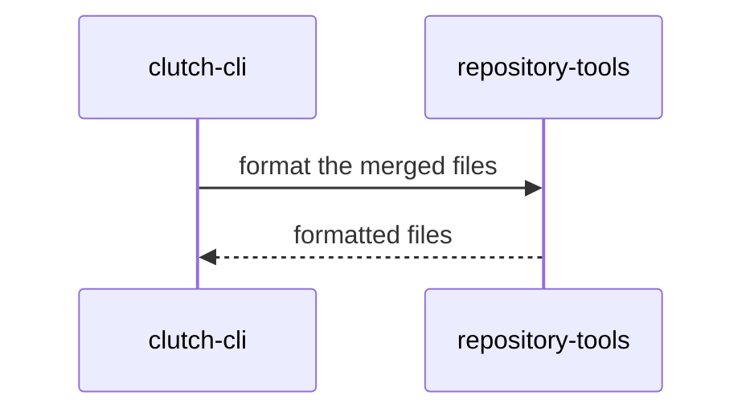

# Recap block

Write one block. Copy the shape below.

- Put the level and the risk in the summary line: `composes` and low,
  `extends` and medium, or `adds` and high.
- Use primitive `id`s from the
  [registry](../../../../docs/contributing/architecture/primitives.yaml) as the
  diagram participants.
- Use a sequence diagram. Add a second diagram only when it shows something the
  first one cannot.
- Label each message with what this PR does.
- Put a blank line after `
` and around each fence. Without them,
  GitHub does not render the diagram.

Add these sections only when they have content. Leave out an empty section.

- **Before and after**: a schema, API or route change, as two short fenced
  blocks or a table.
- **Invariants**: each registry invariant that the change touches, and how the
  change keeps it.
- **Plan and result**: in recap mode, when a plan block came first. Say what
  shipped as planned and what changed from the plan.
- **Preview flows**: for `extends` and `adds`, each flow that you walked on the
  preview.

<!-- system-recap:start -->

System recap: <b>composes existing primitives</b> (low risk)

**Mode:** recap · **Base:** `main` @ `abc1234` · **Head:** `def5678`

**Level:** composes. The change adds no primitive and changes no primitive.

### Primitives touched

| Primitive          | Group      | Level    |
| ------------------ | ---------- | -------- |
| `repository-tools` | repository | composes |
| `clutch-cli`       | repository | composes |

### Change flow

The CLI formats the files it merges with the repository tools.

<!-- system-recap:end -->
